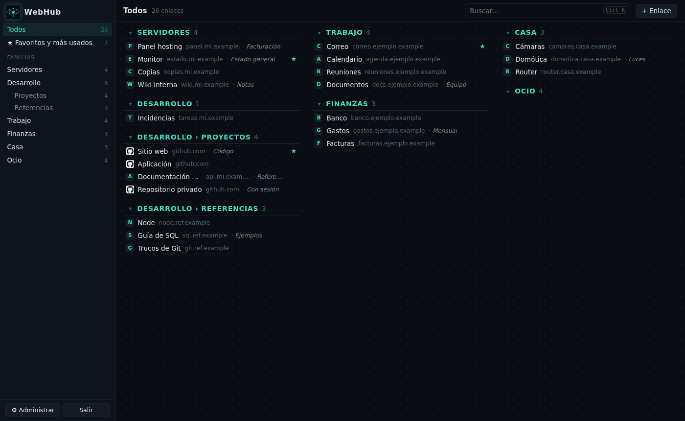
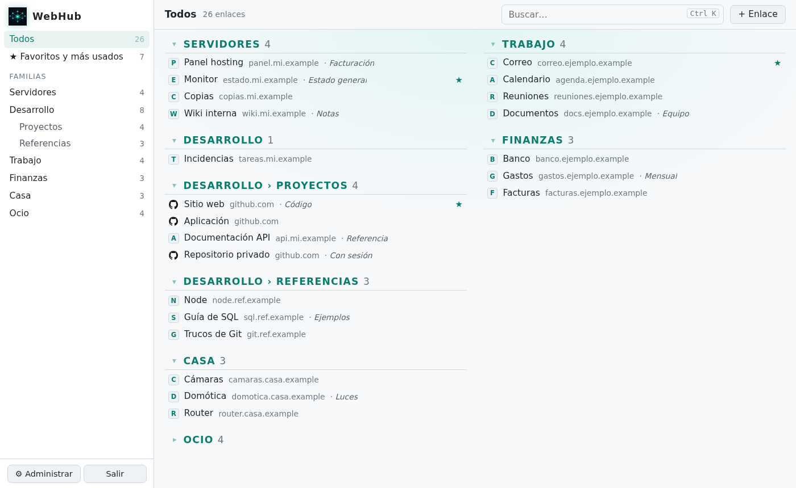
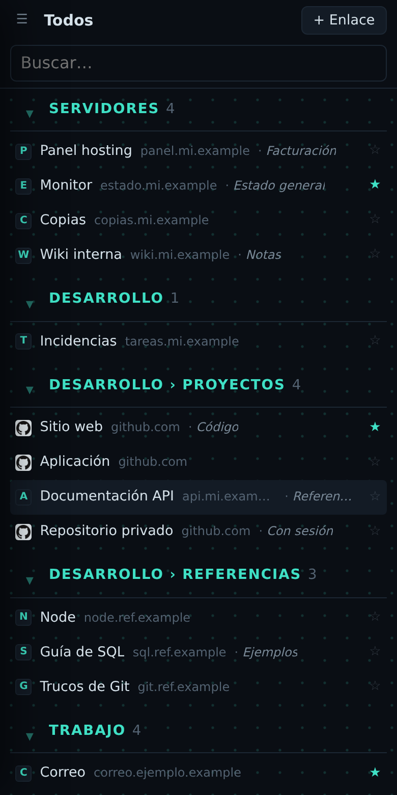
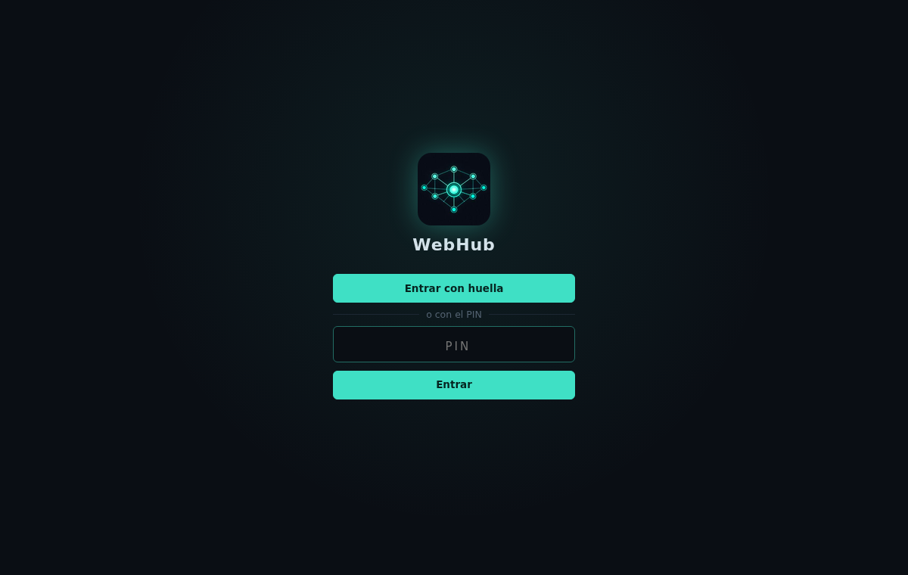
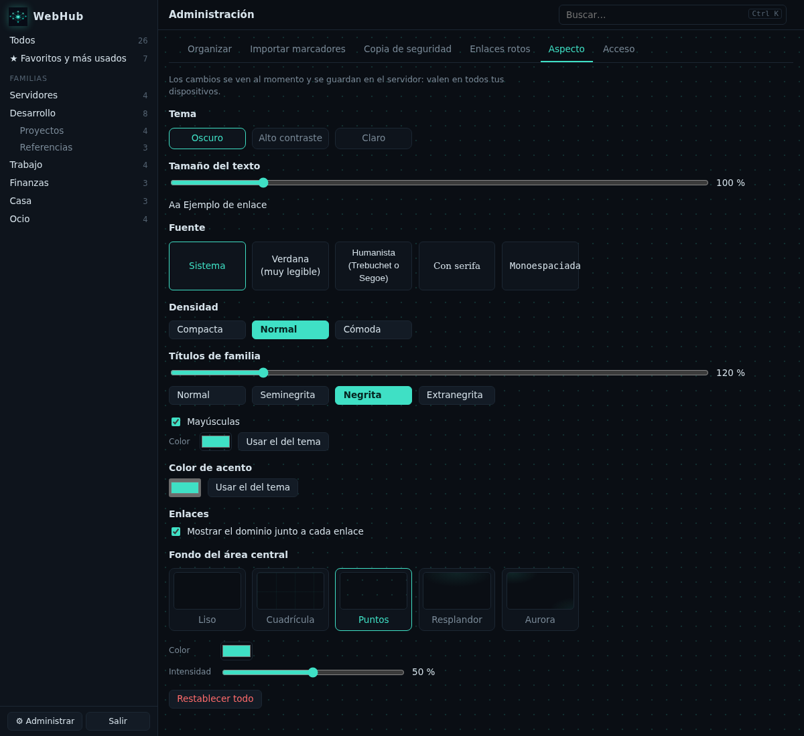
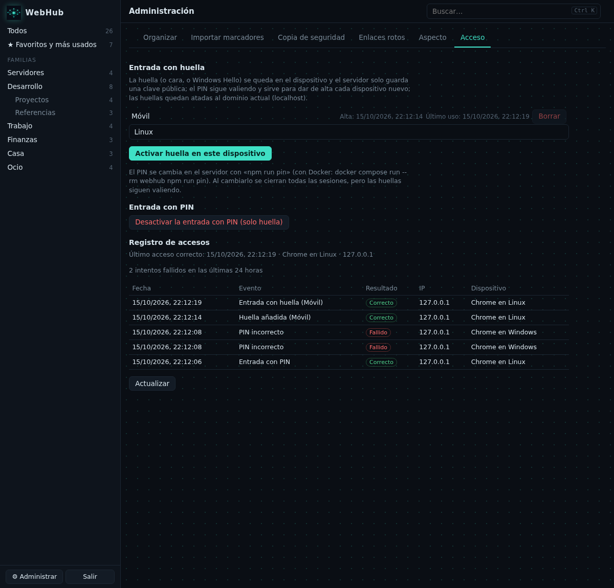
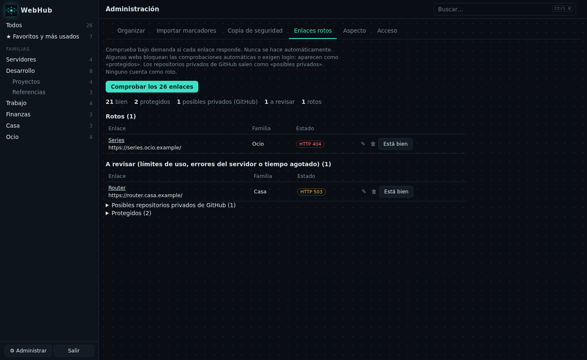

# WebHub


Directorio personal de enlaces de **CatLinux**: todos los servicios, redes, webs propias y webs de interés
ordenados por familias, localizables al instante y en una sola pestaña ligera en lugar de 40 abiertas.

Uso personal, un solo usuario. Toda la aplicación (también la lista de enlaces) exige entrar con un **PIN**
(sin usuario ni contraseña).

## Capturas

Las capturas usan datos de ejemplo inventados (dominios `.example`); ninguna contiene enlaces reales.



| | |
|---|---|
| <br>Tema claro y letra más grande | <br>Una columna en el móvil |
| <br>Entrada con huella o con PIN | <br>Aspecto configurable: tema, texto, fuente y títulos |
| <br>Huellas y registro de accesos | <br>Comprobador de enlaces |

## Funciones

- **Familias y subfamilias** en una barra lateral fija con el número de enlaces de cada una.
- **Listas densas**, una línea por enlace: favicon, título, dominio en gris y nota opcional, en columnas
  para ver muchos enlaces sin desplazarse. Sin tarjetas.
- **Todos los enlaces se abren siempre en una pestaña nueva** (`target="_blank" rel="noopener noreferrer"`).
- **Búsqueda instantánea** por título, dominio, URL, notas, etiquetas y familia, sin distinguir tildes.
- Vistas **Todos** y **Favoritos y más usados** (contador de clics guardado en tu propio servidor).
- **Teclado**: `Ctrl+K` o `/` para buscar, `↓`/`↑` (o `j`/`k`) para moverse, `Enter` para abrir,
  `f` para marcar favorito, `Esc` para volver al buscador.
- **Adaptable a móvil y tablet**: la barra lateral se pliega, el panel de administración pasa a una columna
  y en pantallas táctiles se reordena con botones ↑↓ en lugar de arrastrar.
- **Panel de administración**:
  - crear, editar, borrar y reordenar (arrastrando o con ↑↓) familias y enlaces; mover enlaces entre familias;
  - importar marcadores del navegador (HTML de Chrome, Edge, Firefox…) con vista previa y detección de duplicados;
  - exportar y restaurar todo en JSON;
  - comprobador de enlaces bajo demanda, que los clasifica en bien,
    protegidos, posibles privados, a revisar, rotos e ignorados, con los
    botones «Está bien» y «Volver a vigilar».

- **Analizador de páginas** en el diálogo de enlace: botón «Analizar página» (en
  un enlace nuevo se analiza solo al salir del campo URL); propone título,
  descripción y etiquetas sugeridas, todo con reglas locales sin inteligencia
  artificial ni servicios externos; siempre se puede guardar aunque falle.
- **Reordenar bloques** arrastrando desde su título, solo entre familias del mismo
  nivel; en pantallas táctiles se usa ↑↓ en Administrar › Organizar.
- **Bloques plegables** con flecha ▾; el contador sigue visible y el estado se
  recuerda por dispositivo.
- **Familias plegadas por defecto**: casilla en el diálogo de familia para que
  aparezca con sus enlaces ocultos (título y contador); la marca se guarda en el
  servidor y la preferencia manual de cada persona prevalece.
- **Tooltip propio** con título, URL, nota, etiquetas y número de aperturas, en
  lugar del tooltip nativo del navegador; no aparece en pantallas táctiles.
- **Pestaña «Aspecto»** en Administrar con vista previa al instante: tema
  (Oscuro, Alto contraste, Claro); tamaño del texto (80 % a 200 %); fuente del
  sistema (Sistema, Verdana, Humanista, Con serifa, Monoespaciada); densidad de
  filas; títulos de familia (tamaño, peso, mayúsculas y color propios); color de
  acento; mostrar u ocultar el dominio; fondo del área central (Liso,
  Cuadrícula, Puntos, Resplandor, Aurora) con color e intensidad; y Restablecer
  todo. Se guarda en el servidor y vale en todos los dispositivos.
- **Entrada con huella** mediante passkeys (WebAuthn): huella, cara o Windows
  Hello del dispositivo; el PIN se mantiene como alternativa.
- **Columnas explícitas en «Todos»**: cada familia principal con sus
  subfamilias forma un grupo que se arrastra desde el título de cualquiera de
  sus bloques a cualquier columna y posición; la columna queda guardada en el
  servidor. En pantallas táctiles no se puede cambiar de columna.
- **Registro de accesos**: historial de entradas en Administrar › Acceso, con
  resumen del último acceso correcto y de los intentos fallidos de las últimas
  24 horas; al entrar aparece un aviso superior si hubo intentos fallidos
  desde la entrada anterior.
- **Copia automática de la base de datos**: WebHub hace por sí mismo una copia
  coherente cada día (verificada y publicada de forma atómica), con retención
  y panel en Administrar › Copia de seguridad (última copia, aviso si pasan
  más de 36 horas, botón «Hacer copia ahora», lista). Ver
  [docs/copias.md](docs/copias.md).
- **Aviso de enlace duplicado**: al añadir o editar un enlace cuya URL ya
  existe, el diálogo avisa y el botón pasa a «Añadir igualmente» (o
  «Guardar igualmente»).

WebHub **no guarda contraseñas ni secretos** de ningún tipo (ver [TODO.md](TODO.md)).

## Requisitos

- Node.js **22.18 o superior** (ejecuta TypeScript directamente y trae SQLite integrado).
- Nada más en producción: cero dependencias de ejecución. `esbuild`, `typescript` y `@types/node` solo se usan para compilar.
- **Navegador de 2023 en adelante** para la interfaz (Chrome/Edge 111, Firefox 113, Safari 16.2 o superiores): los temas y colores usan `color-mix()` de CSS.

## Puesta en marcha (local)

```sh
npm ci
npm run build                  # genera public/app.js
npm run pin                    # crea el PIN (de 6 a 12 dígitos)
WEBHUB_INSECURE_COOKIE=1 npm start   # http://127.0.0.1:3000
```

`WEBHUB_INSECURE_COOKIE=1` solo es para probar por `http://` en local. En producción, detrás de HTTPS, no se usa.

En el servidor se ejecuta con Docker (`docker compose`) detrás de Apache con HTTPS de Certbot: sigue
[docs/despliegue.md](docs/despliegue.md), que incluye también la alternativa con systemd y Caddy.

## Configuración

Por variables de entorno:

Con Docker, el dominio (`WEBHUB_PUBLIC_ORIGIN`) no va en `docker-compose.yml`: se
define en el archivo `.env` (cópialo de `.env.ejemplo`); el compose lo lee y falla
con un mensaje claro si falta.

| Variable | Por defecto | Uso |
|---|---|---|
| `WEBHUB_HOST` | `127.0.0.1` | Interfaz de escucha. Déjalo en local y pon un proxy inverso (Apache, Caddy) delante. En Docker, `0.0.0.0` con el puerto publicado solo en `127.0.0.1`. |
| `WEBHUB_PORT` | `3000` | Puerto. |
| `WEBHUB_DATA_DIR` | `./data` | Carpeta de la base de datos SQLite. |
| `WEBHUB_TRUST_PROXY` | (vacío) | `1` detrás del proxy inverso: usa la IP de `X-Forwarded-For` para el límite de intentos. |
| `WEBHUB_PUBLIC_ORIGIN` | (vacío) | p. ej. `https://webhub.ejemplo.com`. Si se define, las peticiones de escritura deben venir de ese origen. Además fija el origen y el dominio (rpId) de las huellas; en producción debe definirse. |
| `WEBHUB_SESSION_DAYS` | `30` | Duración de la sesión. |
| `WEBHUB_INSECURE_COOKIE` | (vacío) | `1` quita el atributo `Secure` de la cookie (solo desarrollo). |
| `WEBHUB_BACKUP` | (activado) | `0` desactiva la copia automática de la base de datos. |
| `WEBHUB_BACKUP_DIR` | `./data/copias` | Carpeta de las copias. |
| `WEBHUB_BACKUP_KEEP` | `14` | Copias diarias a conservar (si no es un entero ≥ 1, 14). |
| `WEBHUB_BACKUP_FIRST_DELAY_MS` | `60000` | Espera antes de la primera revisión (solo diagnóstico y pruebas). |
## Seguridad

- Acceso con un **PIN de 6 a 12 dígitos**, guardado como hash **scrypt** con sal; se crea o cambia por terminal
  (`npm run pin`) y cambiarlo cierra todas las sesiones.
- Sesión por cookie `HttpOnly`, `Secure` y `SameSite=Strict`; en la base de datos solo se guarda el hash del token.
- **Passkeys (huellas):** el servidor solo guarda la clave pública (más id de credencial, algoritmo,
  contador, nombre y fechas); la huella nunca sale del dispositivo. La verificación de usuario (UV) es
  obligatoria. Las huellas quedan atadas al dominio (rpId) y no pasan por el bloqueo escalonado del PIN.
  El PIN se mantiene como alternativa y para dar de alta cada dispositivo.
- Límite de intentos pensado para un PIN: 5 fallos por IP en 15 minutos y, además, un **bloqueo global escalonado**:
  cada 10 fallos seguidos (vengan de las IP que vengan) se bloquea el acceso 15 min, luego 30 min, 1 h… hasta 24 h.
  Tras un día de ataque solo se admiten unos 10 intentos diarios: probar un millón de PIN llevaría siglos.
  Si el bloqueo te afecta a ti, reiniciar el servicio lo borra (`docker compose restart webhub`, o `sudo systemctl restart webhub` sin Docker).
- Protección CSRF: cabecera propia obligatoria en las escrituras y comprobación de `Origin`.
- Solo se admiten URLs `http`/`https` (nunca `javascript:` ni `data:`), también al importar.
- **Peticiones salientes seguras**: el comprobador de enlaces, la descarga de
  favicons y el analizador no pueden alcanzar direcciones internas (loopback,
  redes privadas incluido el host de Docker, enlace local y metadatos de nube,
  100.64/10, multicast, direcciones IPv6 locales y las que llevan una IPv4
  incrustada); la IP se valida al conectar, en cada redirección (máximo 5) y
  solo con `http`/`https`, y se bloquean las formas disfrazadas (IP en decimal,
  hexadecimal o entre corchetes). Un enlace a una red interna aparece como
  «bloqueado (red interna)».
- CSP estricta (`script-src 'self'`), sin `innerHTML` con datos del usuario, `X-Frame-Options: DENY` y `Referrer-Policy: no-referrer`.
- Los registros nunca incluyen cuerpos de petición, cabeceras ni la cookie.
- **Registro de accesos**: historial de eventos de entrada (con PIN y con
  huella) sin guardar el PIN ni cuerpos de peticiones, con resumen del último
  acceso correcto y de los intentos fallidos de las últimas 24 horas y un aviso
  superior al entrar si los hubo; protegido frente a relleno masivo y borrado
  del rastro (límites por hora y totales, purga que conserva los últimos 100
  accesos correctos).
- **Modo solo huella**: permite desactivar la entrada con PIN (solo si hay al
  menos una huella registrada) para que no haya nada que adivinar, con el
  servidor rechazando cualquier PIN con 403 sin comprobarlo; recuperación
  ejecutando `npm run pin` (en Docker,
  `docker compose run --rm webhub npm run pin`).
- **No indexable por buscadores**: WebHub envía la cabecera `X-Robots-Tag`
  en todas las respuestas y un archivo `robots.txt` que prohíbe el rastreo, de
  modo que la aplicación no aparece en los buscadores (antes solo había una
  etiqueta meta en la página de entrada).
- **Copias de la base de datos**: verificadas (`integrity_check`, `user_version`
  y número de filas), escritas primero a un temporal y publicadas con
  renombrado atómico; carpeta con permisos 0700 y archivos 0600 (la base contiene
  el hash del PIN y las claves públicas de las huellas). Antes de restaurar un
  JSON se hace una copia previa; si falla, la restauración se cancela. Ver
  [docs/copias.md](docs/copias.md).

## Desarrollo

```sh
npm test          # tests de lógica: importador, orden, búsqueda, URLs, autenticación y API
npm run typecheck
npm run dev       # compila el cliente y reinicia el servidor al cambiar el código
test/e2e/ejecutar.sh   # prueba en Chromium real con capturas (requiere Playwright instalado aparte)
```

Estructura:

```
src/shared/   lógica común probada con tests (URLs, búsqueda, orden, marcadores, aspecto)
src/server/   servidor HTTP (node:http), SQLite (node:sqlite), autenticación, API
src/client/   interfaz sin framework, empaquetada con esbuild en public/app.js
public/       HTML, CSS, logo y favicons
test/         tests (node:test) y prueba e2e
docs/         guía de despliegue y ejemplos de Apache, Caddy y systemd
docker-compose.yml  despliegue con Docker
```

El logo y los favicons salen de `assets/icono.png` con `python3 scripts/generar-favicons.py` (requiere Pillow).

## Créditos

Creado y mantenido por **CatLinux**.

Sin licencia por ahora: todos los derechos reservados.
